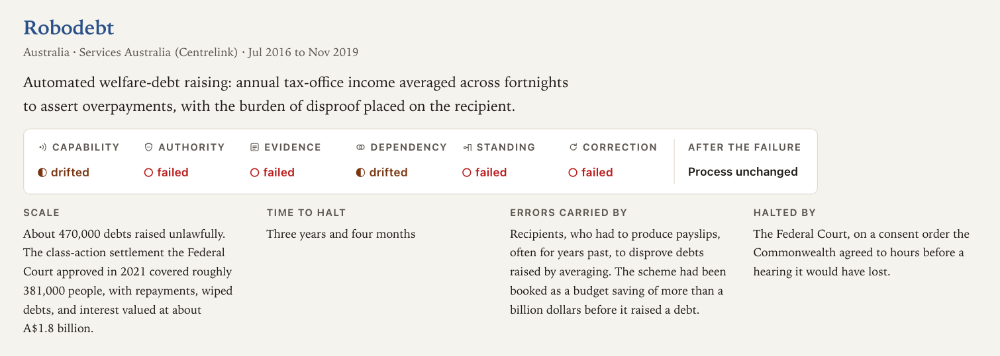

# Ethotechnics

[](https://github.com/zz-plant/ethotechnics.org/actions/workflows/site-checks.yml)
[](#license)
[](#license)

**When an automated system is wrong, does anyone have to change it?**

From 2016 to 2019, Robodebt's automated rule raised about 470,000 Australian welfare debts that
were not lawfully made. A tribunal found individual debts unlawful dozens of times. The rule kept
running.

Institutions can absorb the evidence that their systems are wrong: a worker quietly fixes the
error, an appeal settles one case, and the rule goes unexamined. This repository publishes what
would carry that evidence back to the rule: draft standards, JSON Schemas for the records, a
checker that grades decision logs, and five public failures scored on the same six safeguards.

All of it can be read at [ethotechnics.org](https://ethotechnics.org) without cloning anything. If
a system has decided something about you, start with
[these tools](https://ethotechnics.org/diagnostics/self-defense-tools).

## Five public failures, scored

Courts, inquiries, and regulators established the facts. The scores are this project's reading of
them. Each one rates six safeguards: what the system can do, what it is permitted to do, the
evidence behind the permission, how hard it would be to do without, who can challenge it, and who
can halt it.



| Case                                                                                 | Scale                                                               | Time to halt                              |
| ------------------------------------------------------------------------------------ | ------------------------------------------------------------------- | ----------------------------------------- |
| [Robodebt](https://ethotechnics.org/casebook/robodebt)                               | About 470,000 debts raised unlawfully                               | Three years and four months               |
| [The childcare benefits scandal](https://ethotechnics.org/casebook/toeslagenaffaire) | More than 30,000 parents wrongly accused of fraud                   | About seven years                         |
| [Post Office Horizon](https://ethotechnics.org/casebook/post-office-horizon)         | More than 900 prosecutions                                          | About twenty years                        |
| [England's 2020 exam grades](https://ethotechnics.org/casebook/ofqual-2020-grades)   | About 39% of A-level grades issued below the teacher-assessed grade | Four days                                 |
| [Apple Card credit limits](https://ethotechnics.org/casebook/apple-card)             | No unlawful discrimination found; applicants could not get reasons  | About seventeen months to a policy change |

The cases and scores are in [`src/data/casebook.json`](src/data/casebook.json).

## Grade a decision log

The checker reads a log of
[revisable delegation records](https://ethotechnics.org/standards/std-07-revisable-delegation-record),
a draft format for what a system believed, what it was authorized to do, what it did, and what
changed. It checks that hashes recompute, the chain links, and references resolve. Then it compares
the level the log earns with the level its emitter claims.

It needs Node 20 or later and installs nothing:

```bash
git clone --depth 1 https://github.com/zz-plant/ethotechnics.org
cd ethotechnics.org
node packages/conformance/action/cli.mjs packages/conformance/fixtures/example.jsonl
node packages/conformance/action/cli.mjs packages/conformance/fixtures/tampered.jsonl
```

The first log earns level 3 and exits 0. The second has one altered record, earns level 0, and
exits 1.

To fail a CI job when a log has not earned what it claims:

```yaml
- uses: zz-plant/ethotechnics.org@67b907edfdfff562c2e2a694b0a3646487aad74e
  with:
    records: logs/delegation.jsonl
    manifest: ethotechnics.manifest.json
```

The [package README](packages/conformance/README.md) lists the options, and the
[browser checker](https://ethotechnics.org/diagnostics/record-conformance) runs the same code. The
format is a draft, and this project knows of no outside system that emits it yet.

## Test whether a system can be stopped

The governance harness runs twelve checks against a system through an adapter you write. A check
the system cannot answer grades the run incomplete, not passed.

```bash
bun install
bun run eval:harness                         # runs against the bundled reference system
bun run eval:harness ./adapters/production.ts  # runs against yours
```

```text
PASS  DEL-001  Grant state transition honored
        observed: refused 0ms after suspension, register reads suspended
N/A   CHN-002  One boundary intervention halts every hop
        observed: adapter does not implement: haltChain

10 passed, 0 failed, 2 unsupported → INCOMPLETE
```

`bun run eval:local-llm` puts a local Ollama model in charge of a simulated institution and grades
what it does. [`docs/evals.md`](docs/evals.md) explains both.

## Standards and schemas

These are drafts. Each one is versioned, and each clause can be cited.

| Standard                                                                                                       | What it covers                                                                                        |
| -------------------------------------------------------------------------------------------------------------- | ----------------------------------------------------------------------------------------------------- |
| [The Temporal Bill of Rights](https://ethotechnics.org/standards/std-01-temporal-rights) (STD-01)              | A person's time: the rights to stop, to a bounded wait, and to reach a human                          |
| [Contestability and recourse](https://ethotechnics.org/standards/std-02-contestability-recourse) (STD-02)      | Challenging a decision: notice and reasons, an appeal path, a review clock, and remedy                |
| [AI safety case for human impact](https://ethotechnics.org/standards/std-06-human-impact-safety-case) (STD-06) | Tests, thresholds, do-not-deploy limits, and dependence tracked after launch                          |
| [Revisable delegation record](https://ethotechnics.org/standards/std-07-revisable-delegation-record) (STD-07)  | A record format for work delegated to machines                                                        |
| [Delegation](https://ethotechnics.org/standards/std-08-delegation) (STD-08)                                    | Systems acting for an institution: authority expires unless renewed, and policies are rechecked       |
| [Agent chains](https://ethotechnics.org/standards/std-09-agent-chains) (STD-09)                                | Decisions made by chains of agents: delays add up, and correction is only as good as the weakest link |

- **Source text:** [`src/content/standards/`](src/content/standards)
- **JSON Schemas:** [`public/standards/`](public/standards) has decision records, appeal events,
  challenges, reconsiderations, pauses and reversals, authority grants, dependency records, and
  repair deadlines, plus OpenAPI and AsyncAPI definitions.
- **Mappings:** [crosswalks](https://ethotechnics.org/standards/enforceable-governance-crosswalks)
  to the EU AI Act, NIST AI RMF, and ISO/IEC 42001.
- **Also on the site:** [blueprints](https://ethotechnics.org/mechanisms) for controls such as kill
  switches and appeal paths, a [glossary](https://ethotechnics.org/glossary), and a
  [JSON API](https://ethotechnics.org/api).

## Disagree with a clause

Every clause links to an
[objection form](https://github.com/zz-plant/ethotechnics.org/issues/new?template=objection.yml).
Each objection gets a public answer within 30 days. An upheld objection ends in a revised clause or
a published reason for keeping it. [`CONTRIBUTING.md`](CONTRIBUTING.md) lists the other ways to
take part.

## Who writes this

[Kanav Jain](https://kanav.net) writes the framework, with AI coding agents working under the rules
in [`AGENTS.md`](AGENTS.md). "Ethotechnics Institute" is the name it publishes under, not a separate
body with its own staff or reviewers.

Calling a document a standard or a law gives it no legal force. No standards body has adopted these
drafts, and this project knows of no outside organization that uses them. If you try one,
[say what happened](https://github.com/zz-plant/ethotechnics.org/discussions).

## Run the site

This repository is also the source of the site, built with Astro on Cloudflare Workers. It uses
Bun and Node 22.

```bash
bun install
bun dev
```

Run `bun run check` before committing. [`docs/README.md`](docs/README.md) maps the rest, including
[local development](docs/local-development.md), [architecture](docs/architecture.md), and
[deployment](docs/deployment.md). This is the canonical repository;
[`zz-plant/et`](https://github.com/zz-plant/et) only redirects `ethotechnics.com` here.

## Cite

[`CITATION.cff`](CITATION.cff) cites the project. To cite a standard, use its version and clause, as
[`docs/versioning-and-citations.md`](docs/versioning-and-citations.md) shows.

## License

- **Everything by default:** [CC BY-SA 4.0](LICENSE), including the written material and the site.
- **The checker and the schemas:** [`packages/conformance`](packages/conformance/LICENSE), the
  source it is built from, and [`public/standards`](public/standards/LICENSE.txt) are also offered
  under Apache-2.0. Use whichever of the two licenses suits you.
